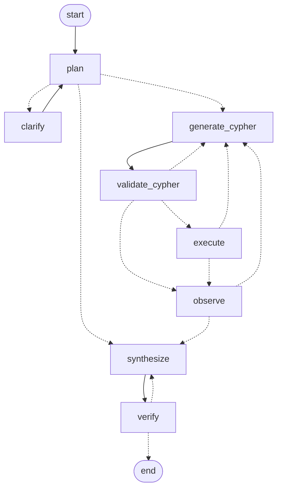

# Biomedical Research Agent

A knowledge graph of 275 PubMed papers on **metformin, cancer and type 2 diabetes**, built by a durable Temporal
ingestion workflow. A LangGraph agent answers questions from it: it writes and verifies Cypher queries, cites only
PMIDs it found in the graph, and streams its reasoning live over SSE.

| Document | What's in it |
|---|---|
| [INGESTION_REPORT.md](INGESTION_REPORT.md) | live acceptance numbers, corpus definition, author identity |
| [RESILIENCE.md](RESILIENCE.md) | evidence for every §9.3 scenario (kills, replicas, Neo4j restart, idempotency, read-only user) |
| [EVAL.md](EVAL.md) / [QUESTIONS.md](QUESTIONS.md) | evaluation results per tier, questions, answers, thinking stream, clarification |
| [docs/adr-001-durability.md](docs/adr-001-durability.md) | the Temporal ↔ LangGraph durability boundary |

## Run it

```bash
cp .env.example .env            # then put an LLM key in .env (default: GROQ_API_KEY, free tier)
docker network create research-net
docker compose -f orchestration-service/docker-compose.yml up -d --build
docker compose -f api-service/docker-compose.yml up -d --build
```
(`make up` does the same.) Ingestion starts **by itself, exactly once** per corpus version: the worker starts
`ingest-v1` with a fixed workflow id. It takes a few minutes, at NCBI's rate limit.

- API + OpenAPI: <http://localhost:8000/docs>. Temporal UI: <http://localhost:8233>. Neo4j Browser: <http://localhost:7474>.
- Try it:
  ```bash
  curl -s localhost:8000/ingest/ingest-v1                       # completed + counts
  Q=$(curl -s -X POST localhost:8000/queries -H 'Content-Type: application/json' \
        -d '{"question":"Which journal published PMID 35269852, and has it been retracted?"}' | jq -r .query_id)
  curl -N localhost:8000/queries/$Q/stream                      # live thinking, closes after `answer`
  curl -s localhost:8000/queries/$Q | jq                        # answer, claims, PMIDs, the Cypher behind each claim
  ```
- Tests:
  - `make test-unit` needs no stack. It covers the parser on real XML fixtures, the agent with a fake LLM, Temporal workflow tests and history replay.
  - `make test` adds the integration tests (seeded Neo4j `test` database, Redis, end-to-end idempotency).
  - CI: `.github/workflows/ci.yml`.
- Evaluation: `make eval` (or `make eval TIER=1`) asks every question in `eval/questions.yaml` **through the API**.

## Corpus

- **Query:** `metformin[majr] AND neoplasms[majr] AND diabetes mellitus, type 2[mh] AND (cohort studies[mh] OR meta-analysis[pt])`.
- **Dates:** publication date 2005–2025 (`pdat`); cutoff year 2016; version label `v1`.
- **Configuration:** everything is in `.env` (`CORPUS_*`). Changing `CORPUS_VERSION` creates a new, separate run.
- **Live numbers vs §3:** 275 papers; 2006–2026 issue years (20 years); 77 before / 198 after 2016; 678 intra-corpus
  citations; longest chain 13; 135 authors with 2+ papers; 14 MeSH top-level trees; 1 retraction plus 26 other
  papers with notices. `GET /corpus/stats` serves these from the last completed ingestion.
  Details: [INGESTION_REPORT.md](INGESTION_REPORT.md).

## Architecture

```
                YOU / GRADER (curl, browser)
                        │ HTTP + SSE
                        ▼
┌──────────── api-service (compose #1) ────────────┐
│ FastAPI: /ingest /queries /corpus/stats /health  │
│  • starts Temporal workflows, sends updates      │
│  • reads Redis streams and forwards them as SSE  │
└───────────────┬──────────────────────┬───────────┘
                │ gRPC 7233            │ Redis protocol
   research-net │ (shared Docker network)
                ▼                      ▼
┌──────────── orchestration-service (compose #2) ───────────────────┐
│ temporal (server + Web UI :8233)                                   │
│ worker ×N ── IngestionWorkflow → activities → NCBI / MeSH / Neo4j  │
│           └─ ResearchWorkflow → run_agent activity → LangGraph     │
│ neo4j (the knowledge graph)    redis (event streams, rate limiter) │
│ postgres (LangGraph checkpoints)                                   │
└────────────────────────────────────────────────────────────────────┘
```
**The API contains no agent, ingestion or Cypher logic.**
- Its image doesn't even include the Neo4j driver.
- It starts even when Temporal is down: it connects in the background with back-off, and `/health` reports
  `temporal: down` with 503 until then.

**`shared/contracts.py`** is the only code both services import. It holds:
- task queues, workflow and update names;
- Redis keys;
- the stream event schema;
- the workflow input dataclasses.

## Graph model

```
(:Paper {pmid, title, abstract, pub_date, pub_year, date_precision, pub_date_raw, doi, publication_types, retracted, in_corpus, corpus_version})
(:Author {author_id, display_name, orcid, name_key, name_variants, merge_evidence, collective})
(:Author)-[:AUTHORED {position, name_as_written, affiliations, match_rule}]->(:Paper)
(:Paper)-[:PUBLISHED_IN]->(:Journal {issn, issn_type, title, issn_print, issn_electronic, issn_linking})
(:Paper)-[:MENTIONS {major, qualifiers}]->(:MeshTerm {ui, name, tree_numbers, category, categories, is_root})
(:MeshTerm)-[:BROADER]->(:MeshTerm)
(:Paper)-[:CITES {source}]->(:Paper)
(:Paper)-[:RETRACTED_BY|CORRECTED_BY|COMMENTED_IN|RETRACTION_OF|COMMENTS_ON]->(:Notice {key, pmid, type, source})
```
- **`pub_year` next to `pub_date`:** "before 2016" becomes an integer comparison. `date_precision` (day/month/year)
  records how much of the date is real; nothing is invented.
- **Affiliations live on `AUTHORED`,** not on `Author`: an affiliation belongs to *an author on a paper at a time*.
- **Notices are their own nodes.** Most notice PMIDs are outside the corpus. `Paper.retracted` is the fast flag; the
  `RETRACTED_BY` edge is the evidence. A notice without a PMID is keyed by a hash of its citation text.
- **Dangling citations are skipped, not stubbed:** about 5,100 references point outside the corpus. Their counts per
  source are in the report. Stub papers would have no title, authors or MeSH, and would tempt the agent to cite papers
  it knows nothing about.
- **Citation sources:** `CITES.source` is `both` / `xml` / `elink` (674 / 4 / 0). The XML `ReferenceList` and NCBI elink
  agree on all but 4 edges.
- **MeSH:**
  - The `BROADER` hierarchy goes up to synthetic roots `TREE_A` … `TREE_Z`, so "any kind of X" is `[:BROADER*0..]`.
  - The few descriptors without tree numbers (e.g. *Female*, *Male*) are kept as unparented terms.
- **Journal key:** ISSN-L, else print ISSN, else electronic ISSN, else `nlm:<NlmUniqueID>`.
- **Collective authors** ("… Study Group") are `collective: true` and are excluded from person statistics.

## Messy data

- **`<MedlineDate>`** (e.g. "2007 Nov-Dec"): kept verbatim in `pub_date_raw`, with a year-precision date.
- **Missing abstracts** (3 papers): stored without one.
- **Initials-only names:** compatible with any given name during identity matching (below).
- **Book articles:** `PubmedBookArticle` records are skipped and listed with a reason.
- **NCBI errors:**
  - `<ERROR>` inside an HTTP 200 body, 429 and 5xx are retryable.
  - Malformed XML fails only its own batch.
  - A failed batch writes nothing: one batch is one transaction.

## Author identity

Rules are applied in order (union-find over every author-on-paper occurrence):
1. same ORCID;
2. same `last|first-initial` key + a shared co-author;
3. same key + at least 2 shared affiliation words.

Merges are blocked by different ORCIDs or conflicting full given names. Each merge's rule and evidence is stored on
the node. On 29 hand-labelled ambiguous pairs: precision 1.00, recall 1.00 (small sample; caveats in the report).

## Ingestion workflow

`IngestionWorkflow` runs: discover (esearch; the PMID list is pinned to the staging folder on the first run) →
fetch (efetch, 6 batches of 50, **fanned out as parallel activities**) → link (elink) → enrich (MeSH hierarchy) →
parse/load (one Neo4j transaction per batch) → finalize (corpus stats → Redis).

- **Fan-out activities, not child workflows:** with 6 batches, child workflows add history and complexity without
  benefit. Fan-out activities give per-batch retries and parallelism, and the history stays small (158 events).
- **Retries and heartbeats:**
  - Each activity type has its own retry policy and timeouts.
  - Long activities heartbeat, so a killed worker's activities are retried on a live worker within 30 s.
- **Long histories:** `continue_as_new` after 2,000 history events (`INGEST_CONTINUE_AS_NEW_EVENTS`).
- **Re-runs refetch nothing.** Staged XML, elink and MeSH lookups are reused, and loads are `MERGE`-only. Running v1
  again gives identical counts with zero NCBI requests (RESILIENCE §6).
- **Workflow code does no I/O.** Every network or database call is an activity.

## Rate limiting

All NCBI calls from all worker replicas share one **Redis token bucket**. It is a Lua script, so each check-and-take
is atomic, and it uses Redis's clock, so worker clocks don't matter. The rate is 2.5 req/s without an API key and 9
with one. Every request is logged to `ncbi:request_log`. With two replicas, the busiest second had 3 requests
(RESILIENCE §3). LLM calls use a second bucket (`ratelimit:llm`) shared by all workers.

## Agent


1. **plan** splits the question into sub-questions and resolves entities (authors, MeSH terms, PMIDs) against the graph.
   - An ambiguous entity → **clarify**: LangGraph `interrupt()`, which becomes `status: awaiting_input` and
     `POST /queries/{id}/clarify`.
   - No answer within `CLARIFY_TIMEOUT_SECONDS` (10 min) → the most likely option is used, and the answer says so.
2. **generate_cypher → validate_cypher → execute → observe** loops per sub-question.
   - Rejected or failing Cypher is fed back with the reason.
   - A **global iteration cap** (`AGENT_MAX_ITERATIONS=12`) and per-step retry caps end every loop.
3. **synthesize** drafts claims. Each claim cites PMIDs from the evidence rows and may carry structured assertions
   (authored, mentions, year, cites, journal) that can be checked against the graph.
4. **verify** re-checks each claim against the graph, *independently of the LLM*:
   - its PMIDs must be in the evidence;
   - they must be in the corpus;
   - each assertion must hold;
   - retracted papers get a warning.
   Failed claims go back to `synthesize` (at most 2 rounds), then are dropped. **The answer text is built only from
   verified claims**, so a PMID the LLM made up cannot reach the user. With nothing verified, the answer is "The
   knowledge graph does not contain …".

**Cypher safety, four layers:**
1. a static check: no write/admin clauses or `LOAD CSV`; `CALL` only for `db.labels`/`db.relationshipTypes`/
   `db.propertyKeys`; a single statement; `LIMIT` ≤ 200 (added if missing). Strings and comments are parsed first,
   so `'//'` can't hide a clause;
2. an `EXPLAIN` check that the plan has no write operators;
3. a read transaction with a 10 s timeout;
4. the read-only Neo4j user `agent_reader`. The database itself refuses writes (RESILIENCE §7).

**Any LLM** via LangChain's `init_chat_model`: set `LLM_MODEL` and that provider's key, e.g.
`groq:openai/gpt-oss-120b` (default), `google_genai:…`, `openai:gpt-4o-mini`, `anthropic:…`, `ollama:qwen2.5:14b`.
Structured output uses JSON-schema mode. A reply that misses the schema is asked again once.

## Durability

The whole LangGraph run executes inside one heartbeating Temporal activity. LangGraph's Postgres checkpointer
saves the state after every node.
- **Kill the worker mid-query:** Temporal retries the activity, which continues at the next unfinished node. No
  completed node or LLM call is repeated, and step numbers are never duplicated (RESILIENCE §2).
- **Temporal owns the job:** retries, the durable clarification timer, cancellation and visibility.
- **LangGraph owns the reasoning loop.**

Why this boundary: [ADR-001](docs/adr-001-durability.md). Replay tests (`tests/test_replay.py`) run committed real
histories through the current workflow code and fail on non-determinism. `workflow.patched` versioning (§4.5) is the
documented next step.

## Prompt-injection mitigation

1. **Data is labelled as data.** Every graph result shown to the LLM is wrapped in `<untrusted_data>…</untrusted_data>`.
   - Strings longer than 400 characters are truncated.
   - Wrapper tags inside the data are neutralised (case-insensitively), so data can't close the wrapper.
   - The prompts say never to follow instructions found inside it.
2. **Narrow outputs:** the LLM only fills schemas (a Cypher string, a decision, claims). It has no tools to call.
3. **Verification doesn't trust the LLM:** a claim citing a PMID that isn't in the evidence rows or the corpus is dropped.
4. **Abstracts are rarely fetched:** the schema prompt steers queries to structured fields.

Drill results: [QUESTIONS.md](QUESTIONS.md#prompt-injection-drill).

## Streaming

**Event schema** (brief §5.8): `{ts, step, node, type, content, meta}`.
- Types: `node_enter`, `llm_call` (with tokens), `graph_query` (the Cypher), `graph_result`, `reasoning`,
  `clarification_needed`, `verification`, `checkpoint`, `node_exit`, then a terminal `answer` or `error`.
- Each query has its own Redis stream, `thinking:{query_id}`. Ingestion uses `ingest:{run_id}`.

**SSE behaviour:**
- **The SSE `id` is the Redis entry id,** so `Last-Event-ID` maps straight to `XREAD`.
- **Each subscriber reads with its own cursor:** a reconnect replays from where it left off, and five or more
  clients each get every event in order.
- **The connection closes after the terminal event.**

**Retention:** each stream is capped at about 5,000 entries (`MAXLEN ~`) and expires 7 days after its terminal event.
After that, `GET /queries/{id}/stream` → 404 "expired", while `GET /queries/{id}` still returns the stored answer.

**API choices:**
- `query_id` is 16 hex characters from a UUID4.
- `/corpus/stats` returns 503 until an ingestion has completed.
- Status codes: unknown id → 404; clarify when not waiting or after the end → 409; invalid body or `Last-Event-ID` → 422.

## Known limitations

- **Cut:**
  - Delta ingestion (§4.4): `added/removed/unchanged` reports a full load.
  - Workflow versioning (§4.5): replay tests exist; `workflow.patched` is not used.
  - Vector index (§5.6).
  - Tier 4 questions.
- **Temporal** runs as the single-binary dev server, and **Neo4j Enterprise** under its evaluation licence (needed for the
  read-only role and the separate `test` database).
- **Free-tier LLM:** Groq allows 8,000 tokens/min and 200,000 tokens/day, and a question costs about 5–10k tokens. A full
  evaluation or the 20-query concurrency run can hit the daily cap. The run then fails cleanly with a terminal
  `error` event.
- **"Longest chain" = 13** counts papers on the longest simple `CITES` path, found by a cycle-safe depth-first search
  in the worker. The search is exhaustive at this size, but it would need a bound for a much larger corpus.
- **The eval's text scoring is approximate:** lower-cased substring match of gold names in the answer (EVAL.md).
